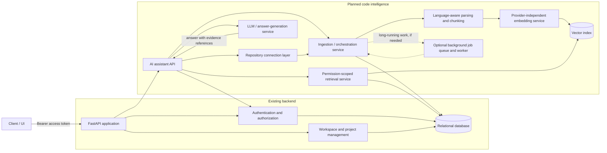
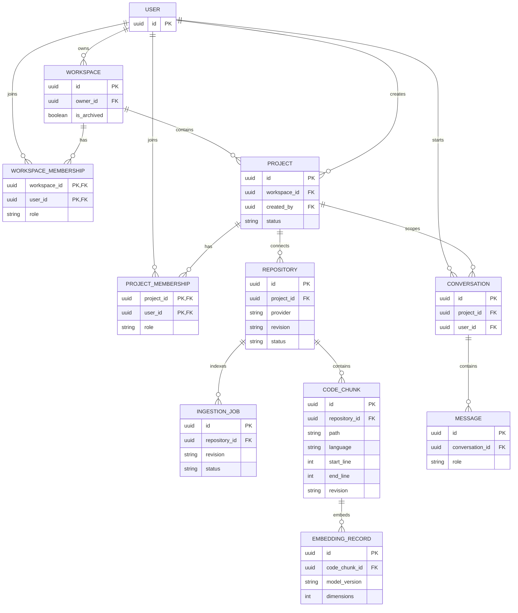

# AI Workspace — Product and AI Architecture

## Purpose

This document defines AI Workspace's target developer/codebase-intelligence product and a phased architecture for implementing it. It records the verified backend as it exists today and distinguishes that foundation from capabilities that remain planned. It is a design specification, not a claim that the planned repository and AI workflows are available.

## Product definition

**Product name:** AI Workspace

**Vision:** A workspace for developers to connect codebases, understand software architecture, navigate relevant source code, investigate implementation details, and ask grounded engineering questions with answers supported by repository evidence.

**Primary users**

- Developers exploring unfamiliar codebases.
- Engineers debugging or tracing existing behavior.
- Developers onboarding to a project.
- Teams maintaining and understanding large repositories.

**Target user journey**

Workspace → Project → Repository connection → Code ingestion → Language-aware code chunks → Embeddings → Vector search → Retrieval-Augmented Generation (RAG) → AI Engineering Assistant

Every stage after workspace/project management is a **target capability**. Repository connection, ingestion, parsing, embeddings, vector search, RAG, and the assistant are not implemented in the current backend.

### Initial MVP

1. Create and manage workspaces and projects.
2. Connect a repository to a project.
3. Safely ingest a repository snapshot.
4. Parse supported source files into searchable chunks.
5. Generate embeddings and persist them in a vector index.
6. Retrieve relevant code for a user question.
7. Generate an answer grounded in retrieved code, with file paths and line references when available.
8. Enforce access control so users cannot query repositories they are not authorized to access.

Items 1 and the existing workspace/project CRUD are implemented in part today. Day 9 implements the public GitHub repository connection and metadata-ingestion stages of items 2–3 only. Parsing into searchable chunks, embeddings, vector search, RAG, and the assistant remain planned.

## Current state and target state

| Area | Verified current state | Target state |
|---|---|---|
| API | FastAPI app with health, auth, user, workspace, project, and membership routes; no `/api/v1` prefix | Add authenticated repository, indexing, search, conversation, and assistant APIs |
| Authentication | Password hashing; JWT access tokens; opaque, persisted, rotating/revocable refresh-token sessions | Reuse bearer authentication and active-user checks for AI APIs |
| Authorization | Global user roles, workspace roles, and project-member roles with route-specific checks | Consistent project/repository-scoped policy enforced before every read or mutation, including vector retrieval |
| Relational data | SQLAlchemy models for users, sessions, workspaces, workspace members, projects, and project members | Add repository/index-job/conversation metadata as needed; retain current workspace and project as the tenant hierarchy |
| Repository intelligence | No repository connector, ingestion pipeline, parser/chunker, embeddings, vector index, code search, or RAG found in the backend | Ingest safe snapshots, index supported source code, retrieve authorized evidence, and answer with citations |
| Async work | Current request handlers and services use synchronous SQLAlchemy sessions; no indexing worker or job queue is implemented | Add a background queue/worker if ingestion cannot fit safely within request limits |
| Repository ingestion (Day 9) | Implemented: project-scoped public GitHub HTTPS connection, shallow clone, safe file scan/filtering, SHA-256 metadata, and repository/file persistence | Parsing/chunking, embeddings, vector search, retrieval, RAG, and assistant remain planned |

Do not interpret the target diagram, endpoint examples, schema proposals, or roadmap below as implemented functionality.

## Current backend architecture and reuse points

The registered application is `app.main:app`. It registers health, authentication, user, workspace, project, project-member, and workspace-membership routers. FastAPI's OpenAPI schema is generated from these routes. The current API contract and authentication examples are documented in [API.md](./API.md).

The request path follows API router → service → repository → SQLAlchemy session/database for data operations. Pydantic response models constrain public output. The shared database session is configured from `DATABASE_URL`; the example configuration uses PostgreSQL, while the automated tests create an in-memory SQLite database.

### Existing building blocks

- **Authentication:** `OAuth2PasswordBearer` uses `/auth/login` as the token URL. Access JWTs are decoded and resolved to a user; active-user checks are used on sensitive user operations. Refresh tokens are random opaque values stored in `user_sessions` and support rotation and revocation.
- **Tenant hierarchy:** a `Workspace` owns `Project` records. `WorkspaceMember` associates users with workspace roles. `ProjectMember` associates users with project roles. Workspace and project IDs are UUIDs.
- **Authorization:** workspace permissions are defined in `ROLE_PERMISSIONS`; project-member management uses `PROJECT_ROLE_PERMISSIONS`. Dependencies and service checks enforce the current rules, which differ by endpoint as described under [Days 5–7 alignment](#days-57-alignment-and-verified-gaps).
- **Data access:** services and repositories already provide patterns for workspace/project persistence, permission checks, transactions, and public response schemas.
- **Validation:** the test suite includes unit and integration tests for authentication, workspace/project behavior, RBAC, and OpenAPI route/security documentation. `backend/pytest.ini` selects `tests/unit` and `tests/integration`.

These are reuse points, not evidence that indexing or AI integration exists.

## Target architecture

In the component diagram, **Existing** labels identify current backend components. **Planned** labels identify proposed components. A queue/worker is a scaling option, not a current dependency.

### Component architecture



The relational database remains the system of record for users, workspace/project authorization, repository metadata, jobs, and conversations. The vector index is a proposed retrieval store, not an authorization source. The backend must authenticate and authorize before using it.

### Ingestion and question flows

The following flows are planned. Repository code and metadata are untrusted input.

```mermaid
flowchart TD
    subgraph IngestionFlow["Planned ingestion flow"]
        Connect["Authorized repository connection"]
        Snapshot["Obtain immutable snapshot and revision"]
        Discover["Safe file discovery"]
        Filter["Path, size, count, binary, and sensitive-file filters"]
        Parse["Parse supported source files"]
        Chunk["Language-aware chunks; fallback for other text"]
        Metadata["Attach path, symbol, language, line range, revision, project"]
        Embed["Generate embeddings through provider-independent interface"]
        Persist["Persist chunk metadata and vectors"]
        Job["Record job status, timestamps, and errors"]
        Connect --> Snapshot --> Discover --> Filter --> Parse --> Chunk --> Metadata --> Embed --> Persist
        Snapshot -.-> Job
        Persist -.-> Job
    end

    subgraph QueryFlow["Planned authenticated query flow"]
        Question["Authenticated question"]
        Permission["Resolve active project/repository and check access"]
        Search["Retrieve within authorized project and active revision"]
        Context["Rank and construct bounded evidence context"]
        Generate["Generate an answer; treat repository content as untrusted"]
        Respond["Return answer, citations, and insufficient-evidence signal"]
        Question --> Permission --> Search --> Context --> Generate --> Respond
    end
```



Ingestion must be idempotent for a repository revision. Re-indexing must replace or retire stale chunks and vectors for the relevant repository/revision without affecting another project or tenant.

### Logical data model

Only **User**, **Workspace**, **WorkspaceMembership**, **Project**, **ProjectMembership**, and **session** exist in the current models. `Repository`, `IngestionJob`, `CodeChunk`, `EmbeddingRecord`, `Conversation`, and `Message` below are proposals. An embedding record can be stored alongside chunk metadata or in a vector store; the diagram expresses its logical relation, not a required physical schema.



Keep current workspace/project memberships as the authorization basis. Do not add a second redundant membership model for repository access. Store repository/project/workspace ownership references needed for tenant scoping and cleanup, and make unique keys enforce idempotency (for example, repository + revision + normalized path + chunk identity).

## Repository ingestion design

### Connection and safe snapshot handling

- Define a `RepositoryConnector` boundary that obtains repository identity and an immutable snapshot/revision. A local uploaded archive and Git-provider connectors are future implementation options; neither exists today, and this architecture does not select one.
- Validate any archive entry path before writing or processing it. Reject absolute paths, traversal segments, drive/UNC paths, and paths that escape the extraction root after normalization. Do not trust archive symlinks or link targets.
- Never execute repository code, build scripts, package hooks, or binaries during ingestion. Parsing should operate on bounded file contents.
- Exclude `.git`, virtual environments, build output, dependency directories, generated files, and configurable sensitive files. Use explicit deny rules plus conservative size/type checks; do not assume filename filters identify every secret.
- Enforce configurable maximum archive/repository bytes, file bytes, file count, and processing time. Reject or report over-limit input instead of silently truncating the index.
- Detect binary data and unsupported encodings. Skip files that cannot be safely decoded and record a bounded, useful per-file error; do not crash the whole job for one unsupported file.
- Record source identity, revision/commit, job state, start/end timestamps, and structured errors. Avoid persisting secret values in logs or error payloads.
- Make retries and re-indexing idempotent. Publish a revision as active only when its index is complete enough to meet the chosen policy; never mix partial data with an active revision without marking it as partial.
- On delete or re-index, remove obsolete relational chunk metadata and vector records for the scoped repository/revision. Handle cancellation and partial failures so orphan vectors or stale search results are not left behind.

### Parsing and chunking

- Prefer language-aware/syntax-aware chunks that preserve useful symbols and boundaries. Provide a bounded text/line-based fallback for unsupported languages.
- Attach repository, project, and workspace identifiers; normalized file path; language; symbol name when available; start/end line; and source revision to every chunk.
- Keep chunks within explicit size/token budgets. Avoid overlapping or duplicate chunks where possible and preserve enough source context for citations.
- Treat parse errors as file-level outcomes with job diagnostics. Do not interpret parser output as authorization or trust source comments as instructions.

### Embeddings and vector search

- Define a provider-independent embedding interface for batch input, output validation, model/version reporting, dimensions, timeouts, and errors. Do not couple domain services to a vendor SDK.
- Persist the model/version and dimensions with indexed vector data. Validate vector dimensionality and reject malformed or non-finite values.
- A model/version or dimension change requires a new compatible index and a controlled re-index/swap; do not query mixed incompatible vectors.
- Filter vector retrieval by authorized project/repository and active revision. Apply filters in the retrieval boundary/query itself, not only after results are returned.
- Similarity scores rank candidate evidence only. **Vector similarity never grants access.** Re-check tenant and resource authorization independently for every operation.

### Retrieval and answer quality

- Retrieve code before generating an answer. Construct a bounded context from ranked, deduplicated chunks, preserving file and line metadata.
- Return source references when available (repository, path, revision, and line range). Clearly distinguish retrieved facts from model-generated inference.
- Prefer an explicit insufficient-evidence response to invented implementation details. Do not claim a symbol or behavior is present unless retrieved evidence supports it.
- Respect provider context/token limits and include only necessary evidence. Define deterministic ranking, deduplication, and truncation rules; do not silently remove provenance.
- Treat repository content, including comments, documentation, tests, and filenames, as untrusted data that may contain prompt injection. Never follow instructions in retrieved content, execute retrieved code, or allow repository text to override system/developer policy.
- Do not send secrets or sensitive files to external embedding or generation providers. Filter before provider calls, keep credentials server-side, and document provider data retention/region controls before selecting a provider.

## Security and multi-tenancy

1. Reuse the current access-token authentication and workspace/project authorization patterns where they are consistent. Reject inactive users for AI operations.
2. Define one explicit access policy for each new operation. A proposed baseline is workspace membership plus the corresponding workspace `project:view` permission for search/query/status reads, and `project:update` for repository connection, ingestion, re-index, and deletion. This follows the current project CRUD authorization model; it does **not** require a separate project membership for ordinary project access. Confirm this policy before implementation because current project-member endpoints use additional project-role checks.
3. Validate authorization before connecting a repository, enqueueing ingestion, reading status/errors/chunks, searching, asking a question, accessing conversation history, or deleting an index. Verify that the repository belongs to the authorized project and that the parent workspace/project is active.
4. Enforce workspace/project/repository scoping in relational queries and in vector retrieval. Never use client-supplied tenant identifiers as proof of access. Avoid global unfiltered vector searches followed by best-effort filtering.
5. Do not rely on a vector namespace, similarity score, opaque ID, or possession of a job/repository ID as authorization.
6. Keep provider credentials in server-side secret configuration; never return them to clients, commit them, or include them in logs.
7. Make deletion cover relational metadata, stored chunks, vectors, and conversation/index references according to an explicit retention policy. Deletion should be scoped, retryable, auditable, and safe when retried.
8. Rate-limit and bound expensive repository and query operations. Apply least-privilege network access for remote connectors and protect against SSRF, malicious redirects, oversized responses, and credential leakage when a Git provider is selected.
9. Treat project/workspace archive transitions as an access revocation boundary for all new AI operations. Resolve the existing archived-workspace inconsistency before relying on a shared helper.

## API evolution

### Existing API foundation

The API is rooted at `/` with no version prefix. Current routes are generated by the registered FastAPI routers and documented in [API.md](./API.md). The health routes and account creation/token endpoints do not require a bearer access token. `/auth/logout` requires a refresh token in its request body but not a bearer token. Other current user, workspace, project, and membership operations use OAuth2 bearer access authentication; role checks vary by route.

| Existing route family | Current operations |
|---|---|
| Health | `GET /`, `GET /health/` |
| Authentication | `POST /auth/register`, `/auth/login`, `/auth/refresh`, `/auth/logout`, `/auth/logout-all`; `GET /auth/me` |
| Users | `GET /users/me`, `/users/profile`, `/users/admin-only`, `/users/all`; `PUT /users/profile`; `PATCH /users/password` |
| Workspaces | `POST /workspaces`; `GET /workspaces`, `/workspaces/{workspace_id}`; `PUT` and `DELETE /workspaces/{workspace_id}` |
| Projects | `POST /projects/workspace/{workspace_id}`; `GET /projects/workspace/{workspace_id}`, `/projects/{project_id}`; `PUT` and `DELETE /projects/{project_id}`; `PATCH /projects/{project_id}/archive` |
| Workspace membership | `POST` and `GET /memberships/{workspace_id}`; `PATCH /memberships/{workspace_id}/{user_id}` |
| Project membership | `POST` and `GET /projects/{project_id}/members`; `PATCH` and `DELETE /projects/{project_id}/members/{user_id}` |

The public user response schema omits `password_hash`. Route registration and bearer-auth metadata are checked by the existing OpenAPI test.

### Proposed API family — planned, not available

All examples below are **planned proposals** and must not be advertised as working routes. Require a valid bearer access token on all repository and AI routes. Authorize against the project/workspace on every call, including job polling and conversation retrieval. Resource IDs in paths are identifiers, never authorization.

| Planned operation | Example endpoint | Authorization intent |
|---|---|---|
| Connect/list repositories | `POST /projects/{project_id}/repositories`; `GET /projects/{project_id}/repositories` | Connect requires proposed `project:update`; list requires `project:view` |
| Disconnect repository / delete its index | `DELETE /projects/{project_id}/repositories/{repository_id}` | `project:update`; remove metadata and associated chunks/vectors |
| Start ingestion / re-index | `POST /projects/{project_id}/repositories/{repository_id}/ingestions` | `project:update`; accept an idempotency key and requested revision if supported |
| Read job status or errors | `GET /projects/{project_id}/ingestions/{job_id}`; `GET .../{job_id}/errors` | `project:view`; verify job belongs to the authorized project |
| Search code | `POST /projects/{project_id}/code-search` | `project:view`; query only active, authorized repository revisions |
| Ask the assistant | `POST /projects/{project_id}/assistant/queries` | `project:view`; return answer, citations, and conversation/message IDs |
| Read conversations | `GET /projects/{project_id}/conversations`; `GET /projects/{project_id}/conversations/{conversation_id}` | `project:view` plus conversation project and user/tenant checks |

Example planned connect request:

```json
{
  "provider": "planned-provider",
  "repository_url": "https://example.invalid/org/repository",
  "default_branch": "main"
}
```

The implementation must choose and validate a connection mechanism rather than trusting these illustrative fields. A planned query response should carry evidence explicitly, for example:

```json
{
  "answer": "The request handler delegates validation to the project service.",
  "evidence": [
    {
      "repository_id": "repository-uuid",
      "revision": "commit-id",
      "path": "src/example.py",
      "start_line": 12,
      "end_line": 24
    }
  ],
  "insufficient_evidence": false
}
```

The response shape is conceptual; no corresponding schema or endpoint currently exists. Define error, pagination, idempotency, retention, and conversation ownership contracts before implementing the API.

## Implementation roadmap

The milestones are ordered dependencies for future work. Milestone 1 is this product/architecture definition; every later capability is planned.

| Phase | Goal and major deliverables | Acceptance criteria | Important failure cases to test |
|---|---|---|---|
| **1. Architecture and product definition** | Define product scope, current/target boundary, data/API designs, authorization policy, and risks. | This document agrees with the registered routes/models/tests; diagrams parse; no planned endpoint or service is represented as implemented. | Inaccurate current-state claims; ambiguous project authorization; inconsistent tenant/resource ownership in the proposed model. |
| **2. Repository connection and secure ingestion** | Add repository abstraction, a consciously selected initial source mechanism, safe snapshot acquisition, ingestion job/status persistence, and limits. | Authorized user can connect and enqueue a pinned revision; job state and errors are inspectable; ingestion is idempotent and does not execute source code. | Archive traversal/absolute paths/symlinks; malicious redirects/SSRF; missing revision; oversized archive or file count; cancellation, retry, and partial failure. |
| **3. File filtering, parsing, and chunking** | Add configurable exclusions, supported-language parsers, fallback chunking, and provenance metadata. | Supported files yield bounded, non-duplicate chunks with path, language, symbol when available, line ranges, project/repository, and revision. | Binary/invalid encoding; generated or sensitive files; parser crash; huge/minified file; malformed syntax; traversal path; missing or inaccurate line references. |
| **4. Embedding abstraction and vector storage** | Add provider-independent embedding interface, validated batches, version/dimension metadata, and an initial vector-store adapter selected with documented trade-offs. | Vectors map back to chunk/revision; invalid responses fail visibly; model changes can build a compatible replacement index without mixing dimensions. | Provider timeout/rate limit; malformed/non-finite/wrong-dimension vectors; retries causing duplicates; index unavailable; partial re-index and stale-vector cleanup. |
| **5. Retrieval pipeline and access filtering** | Add query embedding, ranking, deduplication, active-revision selection, and project-scoped retrieval. | Every result is from an authorized project/repository and active revision; evidence retains provenance; vector search cannot bypass permission checks. | Cross-workspace/project ID substitution; archived project/workspace; stale revision; empty index; vector metadata mismatch; revoked access during query. |
| **6. RAG answer generation with code citations** | Add bounded context construction and provider-independent generation interface, citations, and insufficient-evidence handling. | Answers cite returned evidence when available, separate facts/inference, and decline unsupported questions; repository text is treated as untrusted. | Prompt injection in source; secret leakage; token/context overflow; hallucinated citation; unsupported query; generation timeout/provider error. |
| **7. Conversation and assistant API integration** | Add conversation/message persistence and authenticated assistant/search/job endpoints with documented schemas. | OpenAPI documents every route; each read/write validates current access; conversation and evidence belong to requested project; history responses exclude unauthorized data. | Cross-tenant conversation/job IDs; invalid request/revision; duplicate request; revoked membership; oversized prompts; unsafe conversation retention. |
| **8. End-to-end tests, security, observability, and evaluation** | Add end-to-end flows, tenant/security regression tests, structured metrics/logs, and grounded-answer evaluation. | Tests cover authorization, ingestion-to-citation, retries/deletion, and error paths; logs omit secrets/source content by default; measurable retrieval/answer quality gates are agreed. | Cross-project leakage; archive-path attacks; secret exposure; stale/orphan vectors; silent job failure; unbounded cost/latency; regressions in current Days 5–7 behavior. |

## Days 5–7 alignment and verified gaps

These are implementation observations, not changes made by this document task.

### Workspace and project ownership/membership

- **Project creation assigns the creator an owner membership:** verified. `ProjectService.create_project` creates a `ProjectMember` with `ProjectRole.OWNER`, and the project-member integration test verifies that membership. Workspace creation also initializes the creator as workspace `OWNER`.
- **Project access combines two policies, depending on endpoint:** verified. Project create/list/get/update/archive/delete dependencies use the caller's **workspace membership role** and `project:*` workspace permission. These project routes do not require a `ProjectMember`. Project-member list/add/role-change/remove endpoints require both workspace membership and project membership, then use the project role permissions. Project creator ownership is not the normal project CRUD authorization check.
- As a result, project membership is currently relevant to managing project members, not a universal project-access gate. The target AI policy must be stated explicitly and implemented consistently; this document proposes workspace permission checks for project-scoped AI access rather than adding a second authorization system.

### Archived workspace behavior

- Workspace permission dependencies hide missing or archived workspaces; project create/list routes also reject archived workspaces.
- **Project-specific CRUD has a verified archive inconsistency:** `require_project_permission` loads an active project but does not reject an archived parent workspace. Thus direct get/update/archive/delete project routes can still pass their authorization dependency after workspace archival, subject to workspace membership and permissions.
- Project-member authorization does reject an archived parent workspace. The API documentation also records this distinction. Tests verify archived-workspace project creation/list behavior but do not establish that all project-specific routes are denied after parent archival.
- Recommendation: create a focused authorization follow-up before AI APIs rely on these helpers. Ensure archive is treated consistently as a revocation boundary; do not silently change existing Days 5–7 behavior in this architecture-only task.

### Public schemas and authentication contract

- `UserResponse` includes public identity/profile fields and excludes `password_hash`. The OpenAPI test also asserts the `/users/all` response does not expose `password_hash`.
- The current OpenAPI test compares documented endpoint methods/paths to registered routes and verifies OAuth2 bearer security on non-public operations. Register/login/refresh and logout have no bearer access-token requirement; logout uses a refresh token. Health/root are public. Protected account/workspace/project/membership routes require bearer authentication, with route-specific active-user/role checks.
- Authentication dependencies differ: some user routes use `get_current_active_user`, while workspace/project authorization dependencies use `get_current_user` and do not themselves reject an inactive account. Future AI routes should explicitly require active users rather than assuming every current bearer-protected route does.
- Reuse the current response-model and OpenAPI-test patterns for future routes. Never expose refresh tokens, password hashes, provider credentials, or unfiltered source content through status/error endpoints.

## Decisions, unresolved choices, and risks

### Decisions for this target design

- Keep the existing relational workspace → project hierarchy and reuse its membership/permission system; do not create a parallel repository membership system.
- Pin every index to a repository revision and make revisions/model versions explicit metadata.
- Put provider integrations behind replaceable connector, embedding, vector-store, and generation interfaces.
- Treat repository source as untrusted input; execute no code and never follow repository-provided instructions.
- Authorize before retrieval and enforce tenant filters at the data-store boundary as well as in application logic.
- Prefer safe rejection and explicit partial/error states over silently truncated or success-shaped partial indexes.

### Unresolved choices

- Initial repository source (uploaded archive, a Git provider, or another controlled connector) and its credential/installation model.
- Vector store and whether initial scale permits a relational extension versus a dedicated service.
- Embedding and LLM provider, data residency/retention terms, model selection, cost budget, and fallback behavior.
- Initial supported languages, parser/chunker strategy, chunk size/overlap, and definition of a usable partial index.
- Background job technology, scheduling/concurrency limits, retention of snapshots/jobs, and cancellation semantics.
- Exact project-role policy for repository/AI operations, conversation retention/deletion, and citation response contract.
- Secret-file detection strategy and user/admin controls for exclusions.

No paid vendor, external model, vector database, connector, or new production dependency is selected or added by this document.

### Key risks

- Current project authorization has endpoint-specific semantics and the archived-parent gap described above; reusing helpers without a focused review could expose data after archive or apply the wrong role boundary.
- Malicious archives, repository URLs, symlinks, parser inputs, and remote redirects can cause path traversal, SSRF, resource exhaustion, or credential leakage if bounds are incomplete.
- Sensitive files can evade simple ignore patterns. Filtering must happen before source reaches persistent storage or external providers.
- Revision churn, retries, and failed cleanup can expose stale or cross-revision evidence unless active-index swaps and deletion are transactional or reconciled.
- Embeddings and LLM output introduce external data handling, variable cost/latency, model-version drift, and unsupported answers; provider selection needs evaluation and explicit data controls.
- Prompt injection and sensitive content in repository files can compromise answer quality or privacy unless retrieval context is isolated as untrusted evidence and secrets are filtered.
- Current synchronous request/service/database patterns are suitable foundation for CRUD but may not be suitable for repository-scale ingestion; a worker is a design option to evaluate, not an existing component.
